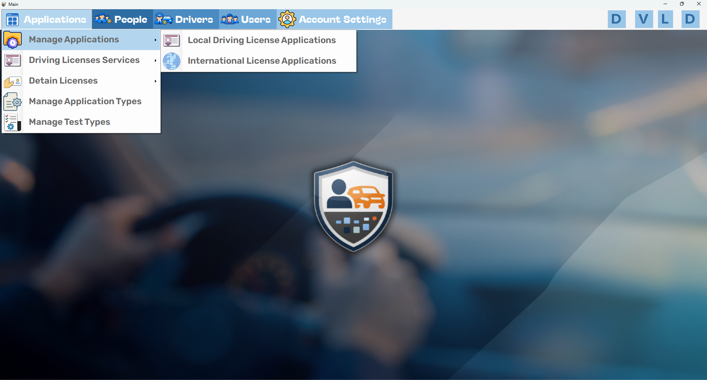
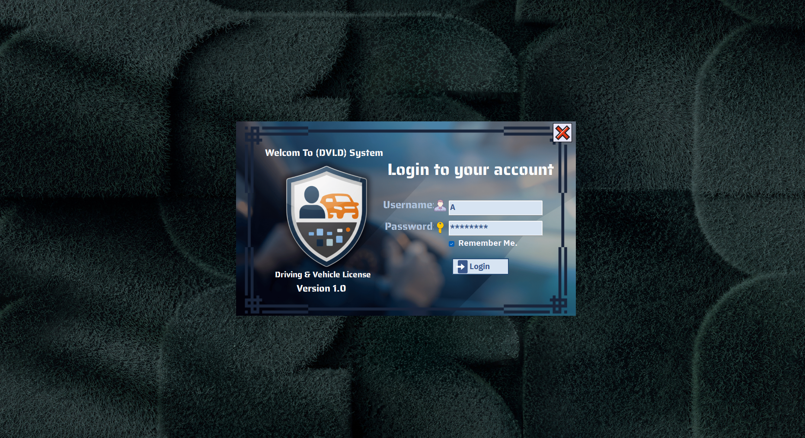
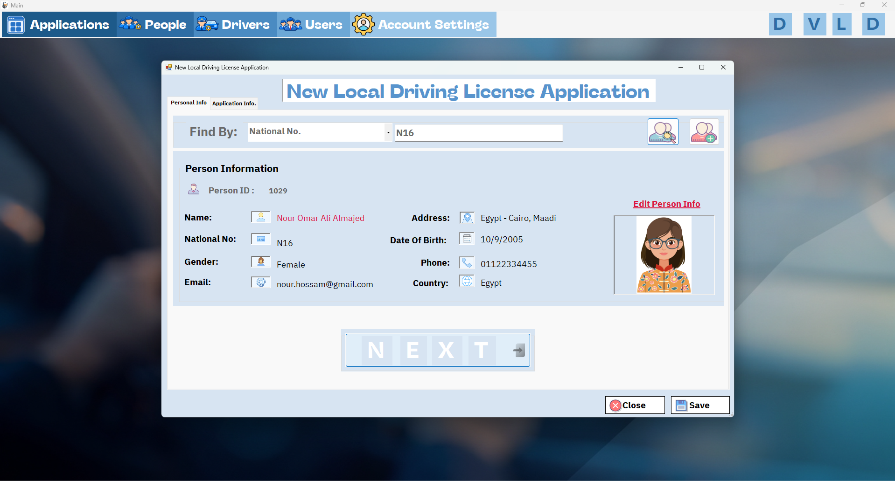
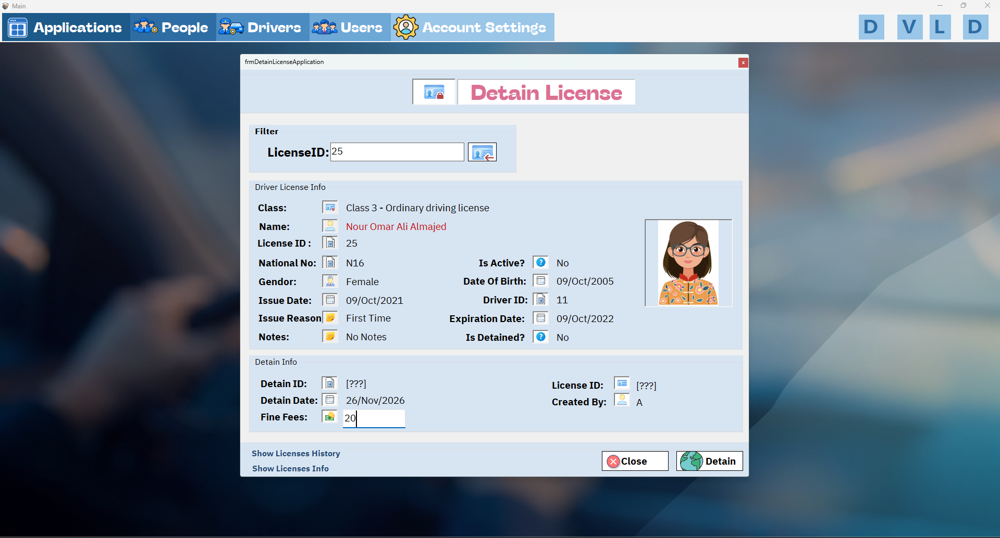
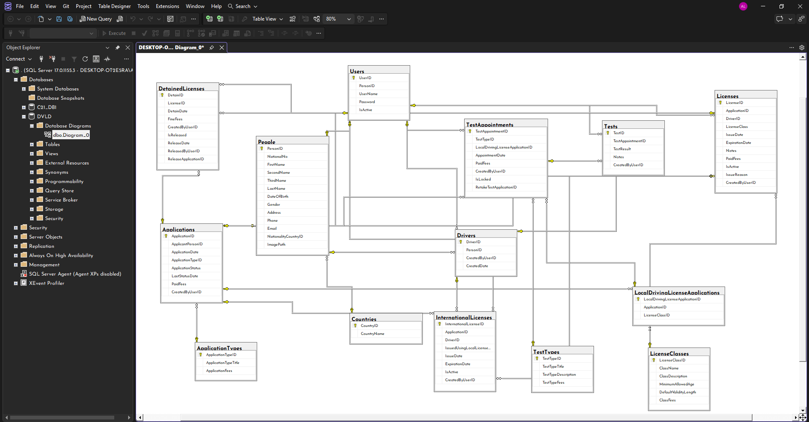

<h1 align="center">DVLD: Driving & Vehicle License Department</h1>

<p align="center">
  
</p>

<p align="center">
  🎥 <b>https://lnkd.in/p/e9dpDtAe</b> (<a href="#">Video Link</a>)
</p>

---

## Description

A desktop application that manages the full lifecycle of driving licenses: applications, mandatory tests, issuing, renewing, replacing, detaining, and international licenses. It is built with C# and WinForms on top of SQL Server, using a 3-Tier Architecture.

This project is the final project of Course 19 on ProgrammingAdvices by Dr. Mohammed Abu-Hadhoud. I used it to practice layered design, OOP, and working with a real relational database.

## Features

**License services**
- Issue a local driving license for the first time (7 license classes, each with its own minimum age, validity period, and fees)
- Three mandatory tests that must be passed in order: Vision, Written, Practical
- Retake test service for applicants who fail a test
- Renew a license
- Replace a lost or damaged license
- Detain and release a license, with fines
- International license, available only for Class 3 (Ordinary) license holders

**Management screens**
- People, Users, and Drivers
- Application types and test types (fees and details)
- Each operation records which user created it

## Screenshots

| Login | New Local License Application |
|:---:|:---:|
|  |  |

| Detain License |
|:---:|
|  |

## Architecture

The solution is split into three projects, each with one responsibility:

```
DVLD.slnx
├── DVLD/              Presentation layer (WinForms UI, user controls)
├── DVLD_Business/     Business layer (entities, validation, security)
└── DVLD_DataAccess/   Data access layer (ADO.NET, SQL queries)
```

The UI never talks to the database directly. It calls the business layer, and the business layer calls the data access layer.

## Database

The database script and the ER diagram are in the [`Database`](Database) folder.

<p align="center">
  
</p>

## Security and Code Quality

- **Password hashing:** passwords are stored as SHA-256 hashes (`DVLD_Business.Security.clsCryptography`), never as plain text.
- **Remember Me:** credentials are kept in the Windows Registry (`HKEY_CURRENT_USER`) instead of a text file, and registry handles are released with `using` blocks.
- **SQL injection:** every query in the data access layer uses parameters.
- **Configuration:** the connection string lives in `App.config` and is read through `ConfigurationManager`, so nothing is hardcoded.
- **OOP:** inheritance is used where it fits, for example `clsLocalDrivingLicenseApplication` inherits from `clsApplication`.

## Tech Stack

| | |
|---|---|
| Language | C# |
| Framework | .NET Framework 4.7.2 |
| UI | Windows Forms |
| Database | Microsoft SQL Server |
| Data access | ADO.NET |
| IDE | Visual Studio |

## How to Run

**Requirements**
- Visual Studio 2019 or 2022 with the **.NET desktop development** workload
- .NET Framework 4.7.2 Developer Pack
- SQL Server and SQL Server Management Studio (SSMS)

**Steps**

1. Clone the repository:
   ```
   git clone https://github.com/mostafa-000/DVLD-Driving-License-Management.git
   ```
2. In SSMS, create an empty database named `DVLD`, then open `Database/DVLD_Script.sql` and run it. It creates the tables and the sample data.
3. Open `DVLD/App.config` and check the connection string. By default it uses Windows Authentication on the local server:
   ```xml
   <add name="DVLDConnection"
        connectionString="Server=.;Database=DVLD;Integrated Security=True;"
        providerName="System.Data.SqlClient" />
   ```
   If your SQL Server is a named instance, use `Server=.\SQLEXPRESS`. If it only accepts SQL Authentication, use:
   ```
   Server=.;Database=DVLD;User Id=YOUR_USER;Password=YOUR_PASSWORD;
   ```
4. Open `DVLD.slnx` in Visual Studio, set **DVLD** as the startup project, and press **F5**.

**Demo login**

| Username | Password |
|:---:|:---:|
| `A` | `111` |

All data in the sample database is fictional and is there for testing only.

## What I Learned

- Separating a project into UI, business, and data access layers, and keeping each layer in its place
- Using inheritance and encapsulation in a larger domain model
- Designing a relational database with clear relationships between people, users, drivers, applications, tests, and licenses
- Handling real security details: hashing, parameterized queries, and keeping secrets out of the repo
- Debugging my own code, for example fixing a double-hashing bug in the Remember Me flow

## Future Improvements

- Move from .NET Framework to modern .NET
- Use a salted password hashing algorithm instead of plain SHA-256
- Build a Web API version with ASP.NET Core and EF Core on the same database

## Acknowledgements

Built as part of Course 19 (Full Real Project) on [ProgrammingAdvices](https://programmingadvices.com) by Dr. Mohammed Abu-Hadhoud.
